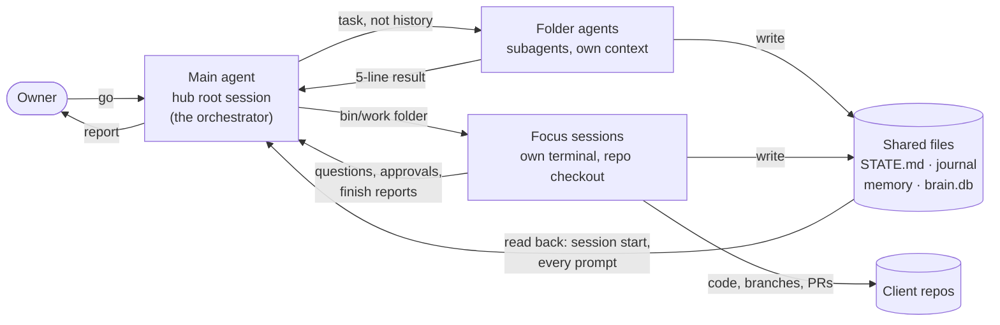
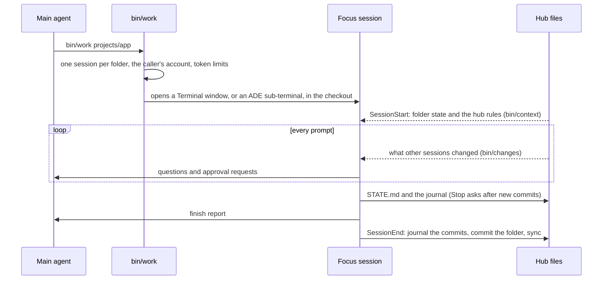

# ade-brain

The brain for agentic development: a template for an **AI technical persona that remembers your work and coordinates
its agents**. The persona can be a staff software engineer, DevOps/SRE, data engineer, QA, security engineer,
architect, tech lead, PM or fractional CTO, working for one client. It runs on Claude Code, inside ADE or in a plain
terminal. (Formerly `ai-agent-hub-template`.)

Each brain is one **hub**: a private repo of Bash and Markdown that holds the **context, state and history** of the
work. Every session starts with what is live, open and waiting; agents keep it up to date; the client's code stays in
its own repos.

## How it works

- **The main agent is the orchestrator.** A Claude session at the hub root reads every folder's state, proposes the
  day's tasks, and on the owner's go hands each one to the folder that owns it. It confirms the result in that
  folder's STATE.md and the journal, then reports in a few lines. Only it (or `bin/sync`) commits to the hub.
- **Folder agents** (`.claude/agents/<folder>.md`) run as its subagents: each gets the task, not the history, loads
  its folder's context and replies in five lines or fewer.
- **Focus sessions** (`bin/work <folder>`) take long or code-heavy work into their own terminal, in the folder's repo
  checkout, with the folder's hooks. `bin/sessions` lists the ones running.
- **Shared files are the memory**: each folder's STATE.md, the journal, `memory/`, and a local search index
  (`bin/brain`). Hooks read them back at session start and on every prompt, so each session knows what the others did.
- **Verified, not vibed**: work follows the ADE rules (`.ade/rules.md`) and BMAD skills, and the tests decide Done.



A focus session, start to end:



**Guide:** [`docs/index.html`](docs/index.html) walks through making a hub, the daily flow, hooks, the brain, auto sync,
monitors and every setting, with flow diagrams.

## Make a hub

```bash
# on GitHub: create a private repo from this template, then clone it
gh repo create my-acme-sre --private --template better-ade/ade-brain --clone
cd my-acme-sre
bin/init --list                                   # the personas
bin/init --persona devops-sre --client "Acme Corp" --owner "Sam Lee" \
  --repo acme/infra=~/code/infra --remote deploy@staging.acme.com:22 --remote-key ~/.ssh/acme \
  --staging-url https://staging.acme.com --secret grafana-token --briefing 08:00
git add -A && git commit -m "Initialize the hub" && git push -u origin main   # once, by hand
bin/setup && bin/doctor
claude
```

Commit `hub.conf` by hand: `bin/init` commits nothing, and `bin/sync` leaves `hub.conf` out. Without it, a fresh clone
falls back to the folder name for the hub name (a different state folder, launchd labels and Keychain service) and has
no secret names to check. `push -u` also sets the upstream auto sync needs. Commit it again whenever you edit it.

Or locally, without GitHub: `bin/init ... --dest ~/Project/acme-sre` copies the template to a new folder first.

| `bin/init` option | Sets |
|---|---|
| `--persona <slug>` | the role (see `personas/`); `--list` shows them |
| `--client`, `--owner` | who the work is for, and who the agent works for (required) |
| `--name` | the hub name (default `<client>-<persona>`) |
| `--folders "projects/a ops/b"` | the work areas (default: the persona's) |
| `--repo owner/name[=checkout]` | code repos; the first folder gets the first repo for deep work |
| `--code-owner <org>` | the GitHub owner for repos named without one |
| `--remote user@host[:port]`, `--remote-key`, `--remote-dir` | the box `bin/remote` reaches over SSH |
| `--staging-url` | checked by `bin/doctor` |
| `--secret <name>` | secret **names** `bin/doctor` checks for in the Keychain (never values) |
| `--briefing HH:MM` | weekday morning-briefing time, this Mac's local time |
| `--claude <cmd>` | the Claude install to run: `claude`, or a wrapper such as `claude-personal` that sets its own `CLAUDE_CONFIG_DIR` |
| `--claude-config-dir <dir>` | that install's config dir (default: read from the wrapper, else `~/.claude`); memory and skills are linked there |
| `--model M`, `--effort E` | the default model and effort for sessions (`bin/work`) and the persona agent (default: the persona's) |
| `--agent-model M` | the folder agents' model (default `sonnet`) |
| `--subagent-model M` | `HUB_SUBAGENT_MODEL`: the fallback for subagents that name no model of their own, e.g. most BMAD skills' (default `sonnet`). `bin/work` sets `CLAUDE_CODE_SUBAGENT_MODEL` to it only when the session doesn't inherit one, so ADE's value wins; no settings file sets it. An explicit model still wins: `bmad-build` writes code on Opus |
| `--briefing-model M` | the morning briefing's model (default `haiku`) |
| `--brain-path <path>` | extra folders, files or globs the brain indexes (e.g. `~/client/docs`, `'~/client/*.md'`), repeatable |
| `--embed-model M`, `--ollama-url URL` | the local embedding model (default `nomic-embed-text`) and Ollama address |
| `--root-model M` | `HUB_ROOT_MODEL`: the hub root (orchestrator) session's model, in its settings (default `sonnet`; a `--model` flag or ADE's still wins) |
| `--compact-window N`, `--bash-max-chars N` | token limits: compact at N tokens (default `200000`) and cap inline Bash output at N characters (default `8000`); `0` leaves Claude's default. See "Saving tokens" |
| `--auto-sync on\|off` | `HUB_AUTO_SYNC`: push the hub every 30 minutes and at each focus session end (default `on`) |

## Personas

| Slug | Role | Default folders | Model |
|---|---|---|---|
| `data-engineer` | Data Engineer | projects/pipelines, projects/warehouse, projects/reporting, ops/data-quality | sonnet |
| `devops-sre` | DevOps / Site Reliability Engineer | ops/environments, ops/ci-cd, ops/monitoring, ops/security | sonnet |
| `engineering-manager` | Engineering Manager | projects/team, projects/delivery, projects/client | sonnet |
| `fractional-cto` | Fractional CTO | projects/strategy, projects/proposals, projects/vendors, projects/client | opus |
| `frontend-engineer` | Frontend Engineer | projects/web, projects/design-system, projects/client | sonnet |
| `ml-ai-engineer` | ML / AI Engineer | projects/models, projects/agents, projects/evals, projects/proposals | opus |
| `mobile-engineer` | Mobile Engineer | projects/ios, projects/android, projects/releases | sonnet |
| `qa-test-engineer` | QA / Test Engineer | projects/app, projects/test-plans, ops/environments | sonnet |
| `security-engineer` | Security Engineer | ops/security, ops/access, projects/app, projects/reviews | opus |
| `solutions-architect` | Solutions Architect | projects/architecture, projects/proposals, projects/client | opus |
| `staff-software-engineer` | Staff Software Engineer | projects/app, projects/proposals, projects/client, ops/environments | opus |
| `tech-lead` | Tech Lead | projects/app, projects/planning, projects/client | sonnet |
| `technical-product-manager` | Technical Product Manager | projects/roadmap, projects/specs, projects/client | sonnet |

Add a persona: copy one in `personas/`, keep the front matter (`title`, `folders`, `model`, `briefing_focus`) and the
`{{CLIENT}}`/`{{OWNER}}` placeholders, and write its habits.

## The brain: searchable memory (SQLite + vectors)

`bin/brain` keeps every Markdown section of the hub (STATE, memory, journal, notes, docs, plus `HUB_BRAIN_PATHS`) in
one SQLite file, `.local/brain.db` (gitignored, one per hub, so clients never mix). Search ranks two signals together:
SQLite FTS5 keywords (names, numbers, IDs) and vectors from a **local Ollama** embedding model (meaning). Nothing leaves
the Mac; no Python packages; without Ollama it still works, keyword only.

```bash
ollama pull nomic-embed-text        # once per Mac
bin/brain index                     # incremental; session end runs it too; --full rebuilds
bin/brain search "what did the client decide about SMS"   # file:line, heading, snippet; --json, -n N
bin/brain status                    # sections, embedded, stale files
```

Files stay the source of truth: agents write STATE, memory and notes as before; the index is rebuilt from them, at each
focus session's end and every 30 minutes by `bin/monitor` (incremental). Sections
that look like they hold a secret are never indexed. `bin/doctor` checks the index is fresh and the model is pulled.

## Models and Claude installs

Every hub pins one Claude install (`HUB_CLAUDE`) and its config dir (`HUB_CLAUDE_CONFIG_DIR`), so `bin/setup` links
memory and skills into the right place wherever you run it, and `bin/doctor` says when the link is missing. Defaults in
`hub.conf`, all overridable per run:

| Setting | Used by | Override |
|---|---|---|
| `HUB_MODEL`, `HUB_EFFORT` | deep-work sessions, the persona agent | `bin/work --model M --effort E` |
| `HUB_AGENT_MODEL` | folder agents (`.claude/agents/*.md`) | `bin/work --agent-model [name=]M`, or edit the agent file |
| `HUB_SUBAGENT_MODEL` | subagents with no model of their own, in `bin/work` sessions (fallback) | an inherited `CLAUDE_CODE_SUBAGENT_MODEL` (e.g. ADE's) |
| `HUB_BRIEFING_MODEL` | `bin/briefing` | `AGENT_BRIEFING_MODEL=M bin/briefing` |
| `HUB_CLAUDE` | every session the hub starts | `bin/work --claude CMD`, `AGENT_CLAUDE=CMD` |

Focus sessions run as the same install and account as whoever starts them: `bin/work` resolves a bare command on the
caller's `PATH` (a new window's login shell may find another `claude` first), and the session keeps the caller's
`CLAUDE_CONFIG_DIR`, or none when the caller has none. A wrapper that exports its own `CLAUDE_CONFIG_DIR` still wins.

When a focus session runs on another account than the hub's, `bin/work` links the hub's memory into that account (and
says so), so what the session remembers still reaches the hub. For hub-root sessions on another account, run
`bin/setup --config-dir <that account's dir>`; `bin/doctor` names a shell account that lacks the link.

Other providers (OpenRouter, Ollama, a second account) work through a wrapper command passed as `--claude`.

## Saving tokens

Most of a session's cost is its context, re-read on every call. Measured on four hubs over 30 days, 69% of context
tokens were in calls already over 200k, and most Bash output came from a few long results. The defaults cap both:

| Limit | Default | Focus sessions (`bin/work`) | Hub root |
|---|---|---|---|
| Compact the context at | 200k tokens (`HUB_COMPACT_WINDOW`) | the launcher exports `CLAUDE_CODE_AUTO_COMPACT_WINDOW` | `autoCompactWindow` in `.claude/settings.json` |
| Inline Bash output | 8,000 characters (`HUB_BASH_MAX_CHARS`) | the launcher exports `BASH_MAX_OUTPUT_LENGTH` | `bashOutputMaxChars` in `.claude/settings.json` |
| The orchestrator's model | `sonnet` (`HUB_ROOT_MODEL`) | (their own `HUB_MODEL`) | `model` in `.claude/settings.json` |

A value the session inherits (ADE's) wins over the launcher's; `0` leaves Claude's default. Longer Bash output goes to a
file with a short preview, which Claude reads only as needed. Code is still written on Opus (`bmad-build`). A hub made
earlier gets the limits when it pulls the template; add `"model": "sonnet"` to its `.claude/settings.json` by hand.
Habits that help too: one task per focus session (`bin/work --prompt "<task>"`), and folder agents' five-line replies.

## Delegating by role

The hub-root session stays on Anthropic (`bin/doctor` and `bin/context` warn if `ANTHROPIC_BASE_URL` points elsewhere). It
hands read-only work to a **role**, and the hub decides which model runs it:

```bash
bin/roles                                                  # each role, its model, why any candidate was skipped
bin/keys                                                   # each AI tool: key stored or missing, and what it still needs
bin/keys set glm                                           # store a tool's key from a hidden prompt (deepseek, glm, muse, gemini)
bin/agent --role reviewer --folder projects/app < task.md  # the task comes on stdin, never as an argument
```

| Role | Default candidates, in order |
|---|---|
| `routine` | `anthropic:sonnet`, `deepseek:sonnet` |
| `triage` | `anthropic:haiku`, `deepseek:haiku` |
| `reviewer` | `deepseek:sonnet`, `anthropic:sonnet` |
| `architect`, `builder` | `anthropic:opus` |

- **Change or add a role in `hub.conf` only:** `HUB_ROLE_REVIEWER="anthropic:opus"`, `HUB_ROLE_DOCS="anthropic:haiku"`.
  Anthropic entries name `opus`, `sonnet`, `haiku` (optional `[1m]`) or a `claude-*` id. The environment cannot set these.
- **A candidate runs only if `bin/work --provider` would allow it:** listed in `HUB_PROVIDERS_ALLOWED`, permitted for this
  hub (DeepSeek: the owner's own hubs only), cleared for delegation, a valid model, its key stored. Otherwise the next one
  is tried. With none usable, nothing runs (exit 2).
- **Read-only.** A delegated agent has `Read`, `Grep` and `Glob`, so `architect` and `builder` advise here; code changes
  stay with folder agents and focus sessions. On a provider run, deny rules keep secret files (`.env*`, `*.pem`, `*.key`,
  `id_rsa*`, `.ssh/`, `.aws/`, `.npmrc`, `.netrc`, `credentials*`, `secrets/`) from those tools.
- **No fallback after a start.** A run that fails or times out (`AGENT_TIMEOUT`, default 540 s, at most 570) exits 1 and
  is not retried elsewhere, so client data never moves to another vendor unnoticed.
- **The report is data.** It is printed between lines carrying a per-call nonce, capped at 20 KB, with the full text in
  `.local/agent-out/` (kept 30 days). `journal/delegations-YYYY-MM.md` records each run, never the task.

## Providers behind Claude Code

A focus session can run Claude Code against DeepSeek instead of Anthropic. The CLI stays Claude Code, so hooks,
`--agents` and session end work as before; only the endpoint and models change. Rows live in `bin/lib.sh`
(contract: `.ade/context/providers.md`).

- **Choose it in `hub.conf` only:** `HUB_PROVIDERS_ALLOWED="anthropic deepseek"` (default `anthropic`) and, for every
  session, `HUB_PROVIDER=deepseek`; or one session with `bin/work --provider deepseek <folder>`. Both are ignored when
  set in the environment.
- **Owner's own hubs only.** DeepSeek's terms allow training on API data and store it in the People's Republic of
  China, so it is refused unless `hub.conf` has `HUB_OWNED_BY_OWNER=1` (never set it in a client hub). `bin/doctor`
  flags a client hub whose allowlist lists deepseek. See ADR 0002.
- **The key:** `bin/keys set deepseek` (or `bin/secret --set deepseek-api-key`). A stored key enables nothing by itself, and each
  hub keeps its own keys in the Keychain under its `HUB_KEYCHAIN_SERVICE`. `bin/doctor` shows whether it is stored, never its value. With no
  key, `bin/work` stops before Claude Code starts.
- **Exposure (credential option 1):** the key is read by Claude Code's `apiKeyHelper` (`bin/secret deepseek-api-key`)
  only, so it is never in the environment, argv or a file; hooks and tool commands cannot see it.
- **No Anthropic credential reaches DeepSeek:** `ANTHROPIC_AUTH_TOKEN`, `ANTHROPIC_API_KEY` and the other names in
  `provider_scrub_vars` (`bin/lib.sh`) would beat the helper, so the session starts without them and drops them from the
  folder's settings; a checkout whose `.claude/settings.json` or `settings.local.json` sets one in `env` is refused.
- **Models:** `--model` is a slot alias (`opus`, `sonnet`, `haiku`) or a row id (`deepseek-flash`, `deepseek-v4-pro`);
  `HUB_DEEPSEEK_MODEL` and `HUB_DEEPSEEK_SMALL_MODEL` change the defaults. `HUB_MODEL` and `HUB_AGENT_MODEL` are not
  used (they may be Anthropic ids). There is no base URL override.
- **Remote Control is off** for a provider session (it needs a claude.ai login), and `--resume`/`--continue` are
  refused: resuming would send an earlier session's history to the new provider.
- **Wrappers:** a provider session needs plain `claude`; `--claude`, `HUB_CLAUDE` or `AGENT_CLAUDE` naming anything else
  is refused.
- **Own config dir:** the session runs with `CLAUDE_CONFIG_DIR=.local/providers/deepseek`, so `/model` cannot change
  your Anthropic default. Claude Code's first-run prompts may show once there.
- **Data sharing:** everything the session reads goes to DeepSeek (code, notes, tool output). That is the owner's
  decision per hub, recorded in ADR 0002; do not use it for client work.
- GLM is disabled until it passes the same checks as DeepSeek. Meta is not offered.

## What a hub has

- **The persona** in `CLAUDE.md` and `.claude/agents/<persona>.md`, with shared rules: verified not vibed, secrets never
  printed, deploys and messages only on the owner's word, client decisions recorded with who and when.
- **One folder per work area** (`projects/<name>`, `ops/<name>`): `CLAUDE.md`, `ACCESS.md` (names and locations, never
  values), `STATE.md` (Live, Staged, Open, Waiting on, Next session starts with), `memory/`, and a named agent.
- **The journal** (`journal/<UTC date>.md`): the shared timeline every agent and hook appends to.
- **Hooks**: SessionStart prints the state; UserPromptSubmit, in every terminal (hub root and deep work), reports what
  other terminals changed since the last prompt (STATE.md updates, new journal entries with their text, new or updated
  memory files with their description); in deep work Stop asks for a STATE update after new commits, and SessionEnd
  journals the commits, commits the folder and starts `bin/sync --auto`, which pushes.
- **Deep work**: `bin/work <folder>` opens a Terminal in the folder's repo checkout with its context and hooks (a folder with no repo, such as an ops watcher, opens in the hub folder itself). `--prompt "<task>"` starts that session with its first message. Every session starts with Remote Control on, named after the folder, so you can follow it from your phone; `--no-remote` turns that off (use it with an API-key wrapper such as an OpenRouter or Ollama one: Remote Control needs a claude.ai login). One session per folder: if that folder's session is already running, `bin/work` refuses (exit 3) and names its pid; `--force` opens another anyway. `bin/sessions` lists the running sessions `bin/work` started (`--mine`: the ones this Claude session started). Inside ADE it opens a sub-terminal of your tab instead, never a window (see "Deep work inside ADE").
- **Tracking focus sessions**: `bin/sessions` lists the sessions `bin/work` started that are still running: name, folder, pid, the session that started each (`--mine` keeps your own), when it started, whether it is `busy` or `idle`, and when that last changed. The folder hooks write the status (a prompt marks busy, the end of a turn marks idle), so it needs no model and no messaging. The launcher also drops Claude session variables left in the terminal by an earlier session, so each focus session starts as its own session and the one that started it can list and message it.
- **Dispatching ready tickets**: `bin/dispatch <folder>` starts a focus builder (`bin/work --role builder`) for each low- or medium-risk `ready_to_start` ticket in the checkout's BMAD `tickets next`, up to `HUB_DISPATCH_MAX` (1 by default, at most 2) running builders hub-wide; high-risk and `hitl` tickets wait for the owner, who starts one with `bin/dispatch --approve <ref> <folder>` at an interactive terminal (typing the ref back) (`.ade/context/dispatch.md`).
- **Scheduled jobs** (`bin/schedule install`, launchd): the weekday morning briefing (`bin/briefing`, Haiku, read-only);
  `bin/monitor` every 30 minutes; and `bin/sync --auto` every 30 minutes; with `HUB_CHAT=telegram`, the chat job.
- **Chat (Telegram)**: `bin/chat setup` lists the one-time steps (a bot from @BotFather, `bin/keys set telegram`, the
  `telegram@claude-plugins-official` plugin, pairing, `/telegram:access policy allowlist`). `bin/chat start|stop|status`
  runs the hub's main session with the channel attached, in `manual` mode (`HUB_CHAT_MODE`), never skipping permissions;
  only your paired account gets in (`.ade/context/chat.md`).
- **Crash recovery**: `bin/recover` runs at login (launchd), before each `bin/chat start`, and by hand. It removes locks
  whose owner is gone, journals agents that died (their ticket marked blocked, never Done; uncommitted work kept and
  listed), drops a torn event-log line, alerts once on a full disk, and tells the chat "restarted, N agents running, M
  waiting" after the orchestrator died. `bin/doctor` shows the same checks read-only (`.ade/context/recover.md`).
- **Auto sync**: `bin/sync --auto` commits and pushes the hub's files unattended: one run at a time, skipped while git
  is busy, refused without gitleaks or without the git hooks (`bin/setup`), every commit to push scanned first, one
  rebase retry, never a force push. One line per run in `~/.agent-hub/<name>/logs/sync.log`. Off: `HUB_AUTO_SYNC=0`
  in `hub.conf` (or `bin/init --auto-sync off`), then `bin/schedule install` again.
  `bin/sync --yes` and the session-end commit share the same lock (`~/.agent-hub/<name>/sync.lock`) and wait at least
  `AGENT_LOCK_WAIT` seconds (default 30) for it; `bin/sync --yes` now exits 1 (`another sync is running`) when the lock
  stays busy. `bin/session-end <folder> --since <epoch>` (run by hand or a launcher) logs one line per run to
  `~/.agent-hub/<name>/logs/session-end.log` (`AGENT_SESSION_END_LOG` overrides it).
- **Monitors**: any executable `projects/<x>/monitors.d/*.sh` or `ops/<x>/monitors.d/*.sh`. Each is read-only; its first
  output line is the status (a leading timestamp such as `Fri 10:05 UTC |` is ignored), and lines starting with `ALERT`
  alert. `bin/monitor` journals a status change and each new ALERT once, and shows a notification for an ALERT. Under
  launchd a monitor gets the plist's PATH only (`~/.local/bin`, Homebrew, system), not your shell profile, and is
  killed after `MONITOR_TIMEOUT` seconds (300).
- **Production change skeletons** in `templates/scripts/`: `staged-change.sh` (check | go | undo, preconditions, a
  backup before any write, auto-undo when the health check fails) and `prodtest.sh` (a read-only PASS/FAIL/WARN test).
  The patterns behind them: `docs/shipping-changes-safely.md`.
- **BMAD v6** skills in `.claude/skills/` for PRDs, specs, stories, builds and reviews, under the ADE rules (`.ade/rules.md`).
  Token defaults (`_bmad/custom/`, synced from ade-method by `bin/method sync`): code is built on the owner's builder
  model (default Opus 5.5); review scales with risk (low none, medium the quick review, high the thorough review on the
  builder's model); quick-review lenses pass no model, so they run on the subagent default (ADE's, else
  `HUB_SUBAGENT_MODEL`), and `bmad-code-review` is quick unless you ask for a thorough review.
- **Access tools**: `bin/remote` (SSH to the box), `bin/secret` (macOS Keychain), `bin/doctor` (what this Mac can reach).

Does a checkout know my work? Yes, as far as the hub's files go: STATE.md, memory, the journal and ACCESS.md are
committed, so a fresh clone (plus `bin/setup`) starts with full context. Secrets, SSH keys and files outside the repo
(downloads, PDFs) are not in it; `bin/doctor` says what is missing on a new Mac.

**A new Mac: clone to the same absolute path.** Several committed files hold the first Mac's absolute paths: each
folder's `.claude/settings.json` (the hook commands), `HUB_CLAUDE_CONFIG_DIR` in `hub.conf`, and `output_folder` in
`_bmad/config.toml`. Use the same user name and folder. Otherwise fix those values: move each folder's
`.claude/settings.json` aside and run `bin/new <folder>` again, edit `hub.conf` and `_bmad/config.toml`, then run
`bin/setup` and `bin/schedule install`.

## Deep work inside ADE

Run from an ADE terminal (or a Claude Code session in one), `bin/work <folder>` opens the session as a sub-terminal of
that tab; the session you ran it from keeps running. **Inside ADE, `bin/work` never opens a Terminal or iTerm window**
(owner rule, 2026-11-09, story W1b): every session opens in ADE, and when ADE cannot open one, `bin/work` fails with
ADE's message instead of falling back to a window. Inside ADE means all four of `ADE_HOOK_BIN` (an executable file),
`ADE_HOOK_PORT`, `ADE_HOOK_TOKEN` and `ADE_PTY_ID` are set, as ADE sets them in every terminal.

First `bin/work` asks the helper what this ADE can do with `ade help`: `"$ADE_HOOK_BIN" help` (stdin from `/dev/null`, at most 5
seconds, stdout only). The probe asks the helper on disk, not the running app: after updating ADE, restart the app if
`ade open` says it is too old. It runs only once the arguments and the folder are checked, so a typo'd folder fails at once.

- **A line starting `capabilities:` with the word `command`** (`capabilities: command`, or `capabilities: command split`
  on a later build; ADE story 9). ADE types the command into the new sub-terminal:

  ```
  "$ADE_HOOK_BIN" open --cwd <checkout> --name <folder> --focus -- bash -l <launcher>
  ```

- **No such line, but a line starting `usage: ade open`** (ADE stories 4a and 4c without story 9, such as v0.23.0): the
  stopgap. `bin/work` opens the sub-terminal with no command (`"$ADE_HOOK_BIN" open --cwd <checkout> --name <folder>
  --focus`), keeps the launcher, prints one line such as
  `work: opened sub-terminal 'acme' in ADE; paste this there to start the session: bash -l '/tmp/agent-work.XXXXXX'`,
  and exits 0. Paste that command into the new sub-terminal to start the session.
- **Neither** (a build without `ade open`, such as v0.22.0, which would take `ade open` as a hook event and do nothing,
  or a helper that did not answer): exit 1 with one `work:` line, nothing opened, no window.

The launcher is the same file the Terminal path runs, so the prompt, the agents and any provider settings stay in it,
never on ADE's command line or in the paste line. `--focus` is always passed, and ADE honours it only when the caller's
tab is the active tab: it shows the new sub-terminal there, but it never switches tabs, and `ade open` exits 0 either
way. What `bin/work` does with `ade open`'s answer:

| Exit | `bin/work` |
|---|---|
| `0` | Done: with a typed command the sub-terminal runs the launcher, which removes itself; in the stopgap `bin/work` prints the command to paste there and keeps the launcher. |
| `1` | ADE refused (an error, the sub-terminal cap, an ADE too old, or no answer in time): prints ADE's reason and that a window needs a terminal outside ADE, exits 1, opens no window. |
| `3`, `4` | ADE is unreachable (stale variables, for example under tmux, or the connection refused): prints ADE's reason, exits 3 or 4, no window. |
| `2` | Fails with exit 2 and opens nothing (a usage error is a bug to fix, not to hide). |
| `5` | The sub-terminal opened but the command was not typed: prints `bash -l <launcher>` to run in it, keeps the launcher, exits 5. No window. (In the stopgap, which sends no command, `5` is a failure like the rows below.) |
| any other | Fails with that code and opens nothing. |

On every failure the launcher is removed and the line ends with the hint to run `bin/work <folder>` from a terminal
outside ADE for a window.

`AGENT_TERMINAL=terminal` or `AGENT_TERMINAL=iterm` inside ADE is refused with exit 2:
"inside ADE every session opens in ADE; run bin/work from a terminal outside ADE for a window".
Outside ADE they open a Terminal or iTerm window as always. `AGENT_TERMINAL=ade` inside ADE is the same as unset; outside ADE it is exit 2 with a message naming the four
variables. Any other value counts as unset. `WORK_DRY=1` inside ADE prints both ADE commands it could run (with
`capabilities: command`, and the stopgap) and never calls the helper. Outside ADE nothing changes, except that the
usage line names `AGENT_TERMINAL=terminal|iterm|ade`.

Live but foreign `ADE_*` variables: a shell that inherited them from an ADE terminal but is not in one (tmux attached
from another terminal, an app launched from an ADE shell) still reaches that ADE, so the session opens as a sub-terminal
of that ADE tab. For a window, unset the four variables there (`env -u ADE_HOOK_BIN bin/work <folder>`).

Interrupting `bin/work` (Ctrl-C) while `ade open` runs removes the launcher, but ADE may already have typed the command:
the new sub-terminal then prints a harmless `No such file or directory`. Close it and run `bin/work` again.

The sub-terminal needs ADE's `ade open` on the ADE build (stories 4a and 4c in `better-agentic-ide`). The typed command
(`ade open -- COMMAND`, story 9) makes it one step; until story 9 is on your build, `bin/work` uses the stopgap above.

## Upgrading a hub made before auto sync

After pulling these scripts into a hub made earlier:

1. Folder sessions hear hub changes only with the new `UserPromptSubmit` hook, and `bin/new` keeps an existing
   `projects/<x>/.claude/settings.json` (or `ops/<x>/...`). For each folder, either move that file aside and run
   `bin/new <folder>` again (it remakes only missing files), or add this line under `"hooks"` by hand, with your hub's
   path and the folder:
   `"UserPromptSubmit": [{ "hooks": [{ "type": "command", "command": "\"/path/to/hub\"/bin/changes projects/<x>" }] }],`
2. Run `bin/schedule install` again to load the monitor and sync jobs.
3. Auto sync is on unless `hub.conf` says `HUB_AUTO_SYNC=0`. It needs gitleaks and `bin/setup` (git hooks); without
   them every run is refused and logged in `sync.log`.

## Tests

`bash tests/run.sh` (macOS, Bash 3.2+). Every `bin/` script has a test run against a throwaway copy with stubbed tools.
